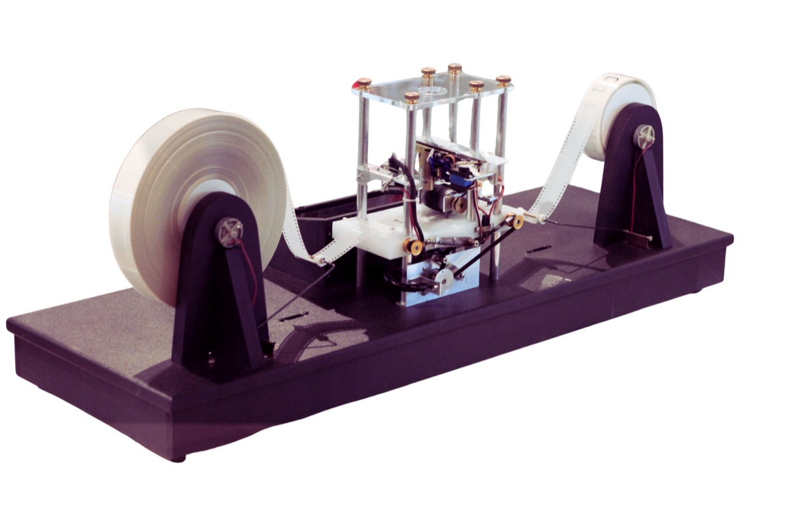
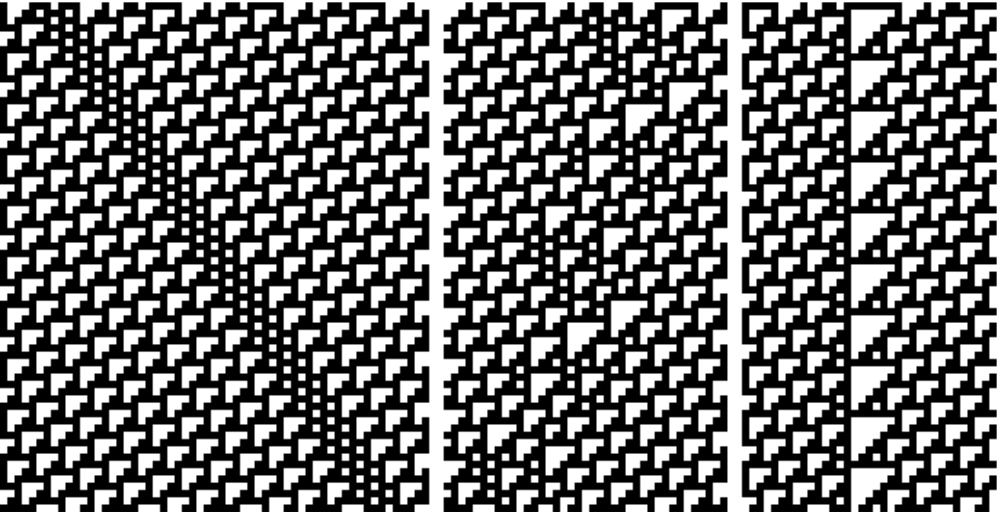
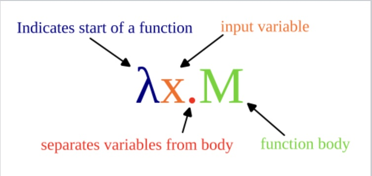
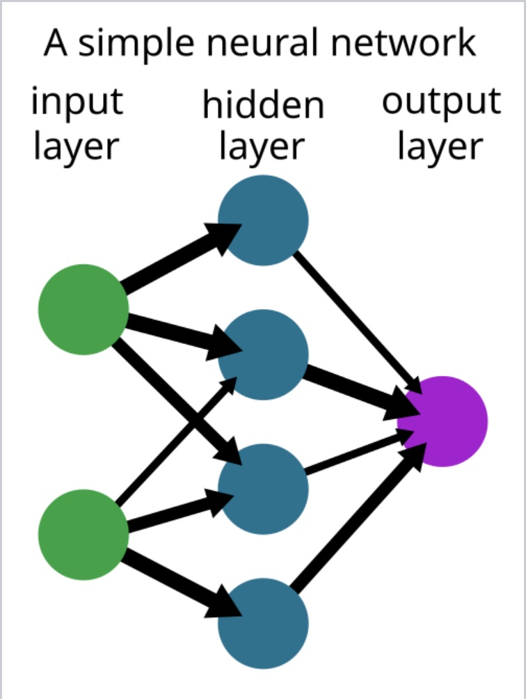
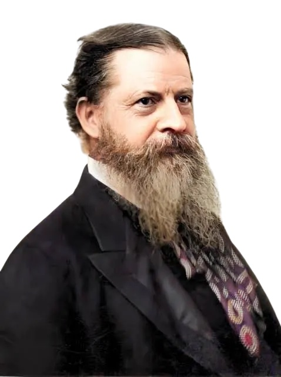
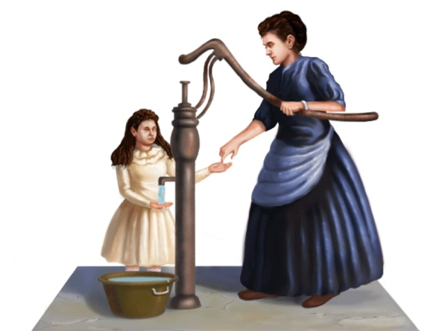

# If LLMs Are Thinking...What Are They Thinking About?

Gene Callahan

## Introduction

Large language models (LLMs), the technology behind ChatGPT, Claude, Gemini,
and their kin, can now carry on conversations that are fluent, informed, and
sometimes startlingly clever. It is no surprise, then, that many people,
including some of the engineers who build these systems, have begun to say that
LLMs *think*.

I am not going to try to settle whether they do. Instead, I want to ask a
different question, one that is oddly neglected: *if* LLMs are thinking, what
are they thinking *about*? My answer will be that, whatever they may be
thinking about, it almost certainly is not what a naïve answer would
say they are thinking about.

### A Few Modest Assumptions

Arguments about minds and machines often get bogged down in metaphysics: Is the
mind a separate substance from the body? Is consciousness an illusion? I want
to avoid all of that. My argument makes no appeal to dualism, or to any other
metaphysical doctrine. It rests on just four assumptions:

1. **Humans engage in semiosis: we mean things.** "Semiosis" means the
   the activity of using signs, such as words,
   pictures, and gestures, to refer to something beyond themselves. If I say
   "dog," I mean an actual, furry, barking animal.
2. **We can do so because we share a common sensory world.** You and I can both
   see, hear, touch, and smell the same dog, and that shared world is what lets
   my word "dog" connect to your idea of a dog.
3. **Some basic computer science.** Nothing beyond what is taught in an
   introductory course, and I will explain all of it below.
4. **Occam's razor.** When choosing between explanations, prefer the simpler
   one.

Someone *could* deny the first or second assumption, but doing so puts one in
a very odd position. A person who writes a book arguing that meaning does not
really exist is, after all, trying to convey a meaning to their readers. And
someone who denies that we share a common world must explain whom, exactly, they
are addressing their argument to, and how it is reaching them.

## Let's Posit That LLMs Think

For the sake of argument, let's grant that LLMs think. How might that be so?
There are at least three plausible routes to that conclusion:

* **Functionalism.** This is the view that what makes something a mind is not
  what it is made of but what it *does*: if a system processes information in
  the right way, it thinks. The trouble is that this view is very hard to
  contain. So many physical systems process information in some way or other
  that functionalism can easily turn into *panpsychism*, the view that mind
  is everywhere, in thermostats and rocks as well as in people.
* **Physical structure.** Perhaps there is something about the physical
  structure of the hardware that runs LLMs which gives rise to thought, just as
  something about the physical structure of our brains seems to.
* **Divine action.** The philosopher Kevin Vallier has suggested that God could
  ensoul machines, just as many believe that God ensouls human beings.

I don't need to choose among these. Let's simply assume LLMs are thinking about
*something*. The question is: what is it?

### The Naïve Answer


*If we ask an LLM "Where is the Eiffel Tower?", is it thinking about Paris?*

The obvious answer is that LLMs are thinking about whatever we asked them to
think about. If we ask "Where is the Eiffel Tower?", the LLM is thinking about
towers, and Paris, and perhaps Gustave Eiffel.

I am going to show why this naïve answer is almost certainly wrong. To do that,
we need to understand the essence of what a computer is.

## What Is the Essence of a Computer?

### The Universal Turing Machine



*A physical model of a Turing machine.*

In the late 1930s, the British mathematician Alan Turing described a remarkably
simple imaginary machine. It consists of a long tape divided into squares, a
head that can read the symbol in one square, write a new symbol there, and move
one square left or right, and a small table of rules telling the head what to
do next based on what it has just read. That's it.

Despite its simplicity, Turing argued that such a machine could carry out any
*algorithm* at all, meaning any step-by-step procedure for computing an answer.
He also showed that one particular machine, the *Universal* Turing Machine,
could imitate any other Turing machine, if it were given a description of that
machine on its tape. In essence, Turing had described the general-purpose,
programmable computer before anyone had built one.

### Another Universal Machine



*Patterns produced by the Rule 110 cellular automaton.*

Universal computers can turn up in surprising places. The scientist Stephen
Wolfram studied *cellular automata*: rows of cells, each either black or
white, where each cell's color in the next row is fixed by a tiny rule about
its color and its neighbors' colors. One such rule, which he called "Rule
110," produces the intricate patterns shown above. Wolfram suspected that this
humble rule was "Turing complete," that is, capable of computing anything a
Universal Turing Machine can. In 2004, the mathematician Matthew Cook proved
that it is.

### The Lambda Calculus



*The basic form of a function in the lambda calculus.*

At almost the same time Turing was devising his machine, the American logician
Alonzo Church came up with a very different-looking system, called the *lambda
calculus*. It has no tape and no moving parts at all: it is just a notation for
defining functions and applying them to inputs, along with a rule for
simplifying the results. An expression such as `λx.M` means "a function that
takes an input `x` and produces `M`."

It turns out that the lambda calculus can simulate any Turing machine, and any
Turing machine can simulate the lambda calculus. Despite looking nothing alike,
they have exactly the same computing power.

### The Church–Turing Thesis

This convergence led to what is now called the *Church–Turing Thesis*: every
system that is equivalent to a Universal Turing Machine can compute exactly
the same set of things. The tape machine, Rule 110, the lambda calculus, the
laptop on your desk, and the vast server farms that run today's LLMs are all,
in this respect, the same.

One important consequence: no hardware upgrade ever expands *what* can be
computed. A faster chip, more memory, or a more clever architecture changes only
*how fast* something can be computed.

### How Does a Digital Computer "Compute"?

Modern computers are possible because *any* system with two reliable states,
such as on and off or hot and cold, can be made to perform computation. We
build computers out of electronics not because electronics are theoretically
superior, but because they are enormously faster. A computer made of water
pipes, or of air pressure valves, could compute exactly the same things as an
electronic one, only much more slowly.

To de-mystify computation, then, let's build a computer out of water.

## Building a Water Computer


Our water computer will run hot and cold water through pipes. Here is how its
parts line up with those of an ordinary electronic computer:

| Water computer | Electronic computer |
|----------------|---------------------|
| Pipes          | Electrical wires    |
| Hot water      | High voltage        |
| Cold water     | Low voltage         |

The two machines are *logically identical*. Anything the electronic version can
compute, the water version can compute too.

### Gates

At certain points in our water computer, two pipes meet in an engineered device
called a *gate*. A gate sends either hot or cold water out of its outlet,
depending on what arrives through its two inlets. Gates are the basic building
blocks of every digital computer; the chip in your phone contains billions of
them.

Let's decide to interpret hot water coming out of a gate as meaning TRUE, and
cold water as meaning FALSE. And let's build a gate that outputs TRUE only if
*both* of its inlets are feeding in TRUE, in other words, hot water. Here is how
our gate behaves:

| Inlet 1 | Inlet 2 | Outlet |
|---------|---------|--------|
| Cold    | Cold    | Cold   |
| Hot     | Cold    | Cold   |
| Cold    | Hot     | Cold   |
| Hot     | Hot     | Hot    |

Read with our chosen interpretation, this is what engineers call an **AND
gate**: the output is TRUE when input 1 AND input 2 are TRUE.

### The Gate Doesn't Know What It Is

But here is the crucial point: *nothing in the physical setup makes this an AND
gate*. That is our interpretation.

Suppose we take the very same device, change nothing about its plumbing, and
simply decide that *cold* water means TRUE and hot water means FALSE. Now the
same table reads:

| Input 1 | Input 2 | Output |
|---------|---------|--------|
| TRUE    | TRUE    | TRUE   |
| FALSE   | TRUE    | TRUE   |
| TRUE    | FALSE   | TRUE   |
| FALSE   | FALSE   | FALSE  |

The output is now TRUE whenever input 1 OR input 2 is TRUE. The identical
device has become a different gate entirely: an **OR gate**.

So even at the level of the simplest logical operation inside a computer, what
the result *means* depends on how we choose to interpret it. The philosopher
Saul Kripke made a similar point: which function a physical machine is
computing is not settled by the physics of the machine alone.

## Let's Answer a Question

Now let's put a few of our gates together and ask our water computer a
question.


*May I enter the baths?*

Imagine a Roman public bath, a *balnea*, with a simple admission policy. Men
bathe during men's hours, women during women's hours, and only citizens may
enter at all. We can wire our water computer to enforce this policy:

* One AND gate checks: is the visitor a man, AND is it men's hours?
* A second AND gate checks: is the visitor a woman, AND is it women's hours?
* An OR gate combines these: is *either* of those conditions met?
* A final AND gate checks: is that so, AND is the visitor a citizen?

If hot water comes out at the bottom, the visitor may enter. A Roman female
citizen, arriving during women's hours, gets a "yes."

### A Different Question!

Now look at a second picture.


*Might I see a moorhen?*

This time a birdwatcher wants to know whether she might see a moorhen. The
logic goes like this: if the bird is nocturnal AND it is night, OR if the bird
is diurnal AND it is day, AND the bird is native to the area, then yes, she
might see one.

Look closely and you'll see that it is *exactly the same circuit*. Same gates,
same pipes, same hot and cold water flowing in the same patterns. One question
is about Roman bathing etiquette; the other is about bird-watching. The water
computer cannot tell the difference, because, from its point of view, there
*is* no difference.

### How Could Our Computer Know the Question?

All the computer "sees" is hot and cold running water. There is not even a
*possible* way to tell it that the question is about baths rather than
moorhens. Whatever we pour into it, it's still just water.

So, if this computer is thinking, it is not thinking about what *we* are
thinking about when we use it!

### All Binary Input Is Similarly Ambiguous

This problem isn't peculiar to bathhouses and birds. Inside any digital
computer, everything is represented as a pattern of two states, which we
conventionally write as 0s and 1s. Take the pattern:

`1011010`

Read as a binary number, this is `90`. But in the standard code computers use
for text, the same pattern stands for the letter "Z." It could just as well be
a shade of gray in a photograph, a note in a song, or a reading from a
thermometer. The pattern itself doesn't say. For all the computer could tell,
it could always simply be a number!

Physicists studying radiation from a binary star and the city government of a
Florida beach town tallying retirees' incomes might, by sheer coincidence,
feed their computers the very same string of bits. The computers would never
know.

## But Don't LLMs Change All This?

Modern LLMs may seem fundamentally different from a water computer. But similar
claims were made about earlier technologies, and all of them overlook the
Church–Turing Thesis. Any system capable of universal computation can perform
the same calculations as any other. An LLM is a very large and complex
computer, but it is still a computer, and everything it does could, in
principle (if absurdly slowly), be done by our water computer.

In fact, LLM training itself *begins* by stripping its inputs of meaning. Words
are chopped into pieces, and each piece is converted into a list of numbers,
which is in turn stored as a pattern of 0s and 1s. If an LLM "learns" to
connect badgers with burrows, what it has really learned is to connect one
pattern of 0s and 1s with another such pattern.

Modern LLMs have upwards of a trillion adjustable settings, called parameters.
But, at bottom, they are still running a function that takes a string of 0s and
1s as input and produces another string of 0s and 1s as output:

`f(0100101) = 1110111`

That this function is enormously complex does not change the fact that it is
still just a function. And as we saw with the water computer, the very same
function could be answering a question about the Eiffel Tower, or about
something else entirely.

### But Isn't That What Human Brains Do?



*A simple artificial neural network. LLMs are built from vast networks of this
kind.*

A natural reply is: "But human brains also just take in electrical signals and
send out electrical signals. If that rules out LLMs knowing about the world,
doesn't it rule out *us* knowing about it, too?"

Notice what this reply actually claims. It is not an argument that LLMs know
the external world; it is an argument that *humans don't*! And that lands us
right back in the odd position of someone denying my first two assumptions.
(Moreover, our brains are in fact very different from Turing machines, and,
despite the name, from the artificial "neural networks" that LLMs are built
on.)

So we have strong reason to believe that humans *do* reach out to the world in
a way computers don't. To see how, we need help from a great American
philosopher.

## C. S. Peirce



*Charles Sanders Peirce (1839–1914).*

Charles Sanders Peirce (pronounced "purse") was a chemist, surveyor,
mathematician, logician, and astronomer, as well as the founder of the modern
study of signs, called *semiotics*, and of the philosophy known as
*pragmatism*. Bertrand Russell called him "certainly the greatest American
thinker ever." Remarkably, Peirce was also a pioneer of the very technology
we're discussing: "As early as 1886, he saw that logical operations could be
carried out by electrical switching circuits."

Peirce sorted the ways things can relate to one another into categories. Two
of them are crucial for us.

### Secondness


Peirce called the first of these *secondness*: a relationship between just two
things. When a rock tumbling down a hill strikes another falling rock and
knocks it off course, we have a purely two-way, or "dyadic," relationship. One
rock pushes, the other is pushed. Neither rock *means* anything by hitting its
companion.

Every gate in our water computer works this way. Hot water arrives, the
device responds, and water leaves. Push and response, all the way through.

### Thirdness

Human language, Peirce pointed out, is different. It is inherently a
three-way, or "triadic," relationship, which he called *thirdness*.

If I shout to you, "A mind-reductionist is creeping up behind you!", I am not
merely sending some sound waves to your eardrums. I am also *referring* to a
third thing: the reductionist. My words are about him.

Peirce analyzed this relationship into three parts:

```
                 Sign
                ("dog")
                /     \
               /       \
          Object ----- Interpretant
     (the actual dog)  (the understanding
                        of the sign as
                        meaning the dog)
```

* The **sign**: the word "dog," spoken or written.
* The **object**: the actual dog the word refers to.
* The **interpretant**: the understanding, in a mind, that links the sign to
  its object.

Peirce held that this three-way relationship cannot be broken down into a
series of two-way ones. However many rocks knock into however many other rocks,
you will never get one rock *meaning* another. And however many gates pass
water to however many other gates, you will never get the water being *about*
Roman baths, or moorhens, or the Eiffel Tower. The meaning only appears when
a human being, who already lives in a world of baths and birds, interprets the
output.

## A Common Sensory World

So how do humans manage to connect their signs to the world? One answer, which
researchers call *embodied cognition*, is that our thinking is rooted in our
bodily experience of the world we share. Here is a famous illustration.



*Helen Keller and Anne Sullivan at the water pump.*

Helen Keller lost her sight and hearing as a small child. Her teacher, Anne
Sullivan, tried for weeks to teach her words by spelling them with her finger
into Keller's palm. Keller could imitate the finger movements, but they meant
nothing to her: they were just patterns.

Now, someone might say: can't we do the equivalent with our computer? We feed
it patterns, just as Sullivan fed Keller patterns.

But that is not how Keller learned what words mean. The breakthrough came when
Sullivan held one of Keller's hands under a stream of water from a pump while
spelling "w-a-t-e-r" into the other. In that moment, Keller later wrote, she
understood that the pattern on her hand *meant* the cool, flowing stuff on her
skin. Sullivan didn't just transmit a pattern. She and Keller shared a common
sensory world: both of them could feel the water. That shared world is what
allowed a sign to connect to its object.

Our water computer, ironically, has no way to feel water. It only *is* water,
flowing through pipes, with nothing to connect that water to anything beyond
itself.

## So What Is an LLM Thinking?

If an LLM is thinking at all, then, what is it thinking about?

There is a vastly simpler hypothesis than "it is thinking about Paris": it is
thinking *the lambda calculus*. That is, it is "thinking" about the abstract
functions it is computing, the patterns of 0s and 1s turning into other
patterns of 0s and 1s. We *know* that this accounts for everything happening
in an LLM, thanks to the Church–Turing Thesis: every computation an LLM
performs can be expressed as an expression in the lambda calculus.

To be clear, my claim is not that LLMs *are* thinking the lambda calculus. It is
that this is a simple hypothesis that accounts for everything we know about
them. The alternative, that the LLM is thinking about towers and Paris,
requires us to suppose that the machine has somehow broken through to a world
it has no access to, and which it could not distinguish from countless other
worlds that happen to produce the same patterns of bits.

## We Just Need Occam's Razor


*William of Ockham (c. 1287–1347), in stained glass.*

The fourteenth-century English friar William of Ockham gave his name to a
principle that has guided careful thinkers ever since: *don't multiply
entities beyond necessity*. When two explanations account for the same facts,
prefer the one that assumes less.


We have two hypotheses about what an LLM, if it thinks, is thinking about. One
says it is thinking about whatever our question concerns: towers, cities,
baths, birds. The other says it is "thinking" the computation it is actually
performing, and nothing more. The second hypothesis explains everything the
first does, and it requires no mysterious bridge between patterns of bits and
the world we humans share.

Occam's razor tells us which to choose. *If* LLMs are thinking, they are not
there are many simpler possibilities than supposing they are thinking about all
the various things we ask them when we use them.

QED.
